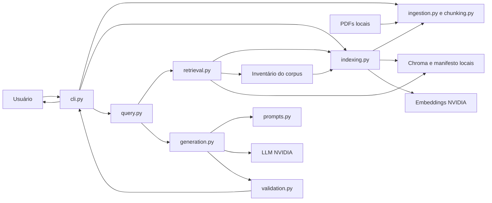
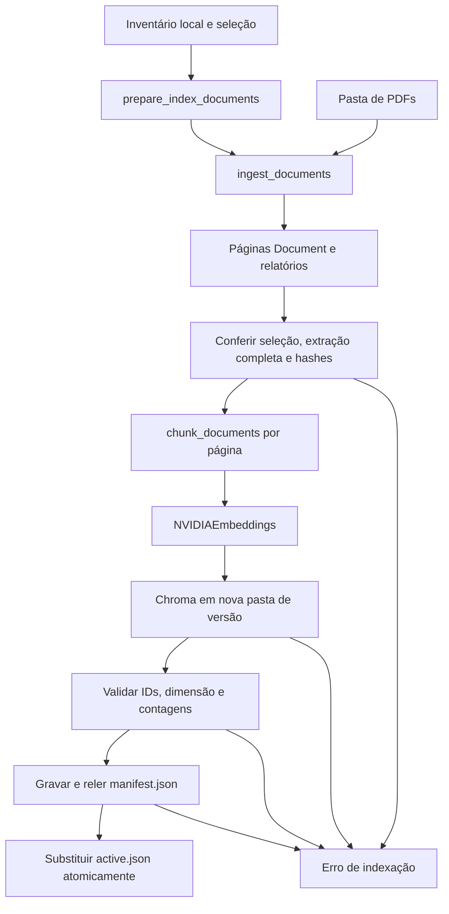
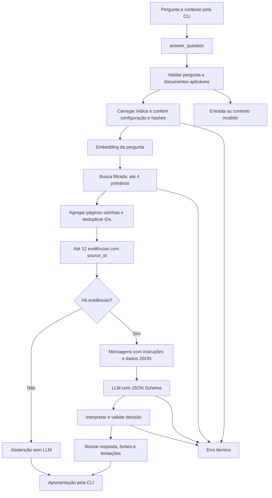
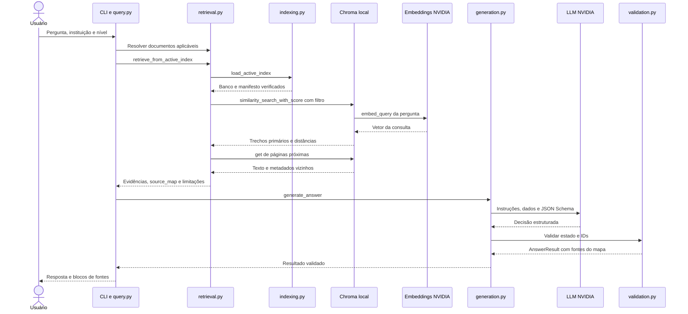

# Assistente de Regulamentos Acadêmicos

Sistema RAG (*Retrieval-Augmented Generation*) em Python e LangChain para consultar regulamentos acadêmicos em PDF por meio de perguntas em português. A aplicação recupera trechos dos documentos cadastrados, solicita uma resposta ao modelo de linguagem e apresenta fontes com nome do arquivo, página física e excerto literal.

Regulamentos extensos, linguagem formal, informações distribuídas entre artigos e condições específicas tornam a consulta acadêmica difícil. Uma busca por palavra pode encontrar o assunto sem esclarecer o procedimento ou suas exceções. A proposta é ajudar estudantes e equipes acadêmicas a localizar e compreender evidências sobre frequência, avaliação, trancamento, aproveitamento e outros procedimentos, mantendo a possibilidade de conferir o texto oficial.

O assistente apoia a consulta; não certifica a vigência das normas nem substitui os documentos ou os setores responsáveis. Para desenvolvedores, este README descreve o fluxo implementado, suas decisões, como reproduzi-lo e como avaliar a fidelidade das respostas.

> [!IMPORTANT]
> O fluxo completo está implementado pela CLI, mas a avaliação com o modelo real encontrou falhas semânticas. Citações estruturalmente válidas e recuperação correta não garantem uma conclusão correta. As limitações e os resultados estão documentados abaixo.

## 1. Escopo e estado atual

Documentação conferida contra código, lockfile, testes e artefatos locais disponíveis em **14 de outubro de 2026**, versão `0.1.0`. As especificações preservam o histórico; seus escopos antigos não representam necessariamente o comportamento atual.

| Capacidade | Estado e evidência |
| --- | --- |
| Ler PDFs locais por página e reportar problemas | Implementada em `ingestion.py`; não modifica os arquivos |
| Dividir texto e preservar origem | Implementada em `chunking.py`, sem cruzar páginas |
| Gerar embeddings e persistir um índice | Implementada em `indexing.py`, com NVIDIA e Chroma local |
| Reutilizar e reconstruir o índice | Implementada com manifesto, versões isoladas e referência ativa |
| Filtrar fontes por contexto acadêmico | Implementada em `retrieval.py`: instituição, nível, campus e modalidade |
| Gerar resposta e apresentar fontes | Implementada em `generation.py`, `validation.py` e CLI `ask` |
| Resposta parcial, conflito e abstenção | Contratos implementados; classificação semântica depende do modelo |
| Testes offline e avaliação com modelo real | Implementados; 148 testes offline passaram; correções pós-revisão verificadas em seis casos reais/sintéticos |
| Verificar vigência, revogação ou período letivo | Não implementado; hash identifica conteúdo, não validade normativa |
| OCR integrado, busca híbrida e reranking | Não implementados |
| Interface web, API, autenticação e histórico de conversa | Não implementados; interface atual é uma consulta por comando |

As SPEC-001 a SPEC-012 estão registradas como concluídas, com as limitações semânticas da avaliação. A [SPEC-013 — Proveniência da avaliação e regressões semânticas](specs/013-proveniencia-e-regressoes-semanticas.md) está em validação: a regressão anterior foi revisada por Manoel, as duas mudanças de produto foram implementadas e uma nova regressão integral concluiu 21 casos, com repetição de duas falhas do provedor. A revisão humana dessa nova regressão ainda está pendente. As demais evoluções da seção 14 continuam propostas.

### Corpus disponível no ambiente de desenvolvimento

O inventário local seleciona dois documentos discentes do IFMA:

| Arquivo local | Identificação revisada | Escopo registrado |
| --- | --- | --- |
| `doc3.pdf` | Guia do Estudante da Graduação, 2ª edição, 2025; 35 páginas | Fonte complementar da graduação no Campus São Luís–Monte Castelo |
| `doc4.pdf` | Anexo à Resolução nº 117/2013 — Normas Gerais dos Cursos de Graduação; 32 páginas | Norma geral de graduação; vigência atual não comprovada |

`doc1.pdf` e `doc2.pdf` permanecem na pasta, mas foram excluídos manualmente da seleção por tratarem de carreira técnico-administrativa e terem texto extraído idêntico. A aplicação não detecta automaticamente duplicatas textuais.

O inventário registra `doc4.pdf` como versão após OCR fornecida externamente. Isso não significa que a aplicação execute OCR. O responsável substituiu o arquivo digitalizado anterior; o hash cadastrado corresponde à versão atual.

PDFs, inventário, índice e avaliações reais são locais e ignorados pelo Git. **Um checkout novo não contém o corpus pronto para consulta.** É necessário fornecer documentos e cadastrar o inventário conforme a seção 12.

## 2. Fundamentação teórica aplicada

### 2.1. LLMs: geração condicionada e conhecimento paramétrico

Um LLM é um modelo treinado em grandes coleções de texto para aprender padrões de linguagem e produzir sequências de tokens condicionadas à entrada. Em modelos de chat, essa entrada inclui instruções, pergunta e contexto. O conhecimento aprendido fica distribuído nos parâmetros do modelo; as evidências colocadas no prompt são informações fornecidas durante a consulta, sem atualização desses parâmetros.

Um modelo isolado pode desconhecer um regulamento institucional, ter aprendido uma versão anterior ou produzir uma resposta plausível baseada em outras instituições. Fluência não comprova origem, vigência ou correção: a geração pode introduzir fatos sem suporte, fenômeno frequentemente chamado de alucinação. A distinção entre conhecimento paramétrico e memória documental externa é discutida no [trabalho de Lewis et al. sobre RAG](https://arxiv.org/abs/2005.11401).

Neste projeto, `create_chat_model()` configura `ChatNVIDIA` com `nvidia/nemotron-3-super-120b-a12b`. O modelo redige uma decisão estruturada a partir dos dados de `build_generation_messages()`. Não é treinado com os PDFs e não escolhe caminhos de execução. `temperature=0.0` reduz variação na amostragem, mas não prova fidelidade, determinismo absoluto ou ausência de alucinações.

### 2.2. RAG: recuperar antes de responder

RAG combina recuperação de informação externa e geração condicionada a essa informação. O artigo de [Lewis et al.](https://arxiv.org/abs/2005.11401) apresenta a combinação entre memória paramétrica e não paramétrica; esta aplicação usa recuperação seguida de geração, sem reproduzir o treinamento conjunto do artigo.

Aqui, o índice persistente representa a base documental externa. A pergunta passa por `retrieve_from_active_index()`, e os excertos encontrados seguem para `generate_answer()`. Isso permite atualizar os documentos por reconstrução do índice, sem treinar novamente o LLM, e fornecer referências verificáveis. A [documentação de recuperação do LangChain](https://docs.langchain.com/oss/python/deepagents/retrieval) descreve esse padrão de duas etapas.

RAG é adequado porque a resposta deve depender de um corpus institucional delimitado, não de lembranças gerais do modelo. Entretanto, só consegue usar o que foi extraído e recuperado: uma exceção ausente pode levar a uma resposta incompleta. Tampouco resolve automaticamente conflito, vigência ou interpretação normativa. O código separa essas responsabilidades para permitir avaliar onde ocorreu a falha.

### 2.3. Embeddings e busca semântica

Embeddings representam textos por vetores numéricos. O modelo é treinado para organizar essas representações de modo que relações textuais úteis à recuperação apareçam na proximidade vetorial. Documentos e consulta precisam de representações compatíveis; `load_active_index()` exige o mesmo provedor, modelo e dimensão registrados na indexação.

`NVIDIAEmbeddings`, criado em `indexing.py`, gera vetores dos trechos e da pergunta. O padrão é `nvidia/nemotron-3-embed-1b`, com dimensão esperada de 2.048. A fábrica passa o nome do modelo; a dimensão é conferida no banco, não enviada como parâmetro para redimensionar vetores. A integração está descrita na [documentação oficial do LangChain](https://docs.langchain.com/oss/python/integrations/embeddings/nvidia_ai_endpoints).

A busca por palavras-chave procura ocorrências ou combinações lexicais; a busca vetorial pode aproximar formulações diferentes sobre o mesmo assunto. Isso ajuda com perguntas informais, mas pode confundir dispositivos próximos: frequência e avaliação, revisão e reposição de prova, dias úteis e corridos. Números, negações, condições cumulativas e termos normativos não devem ser interpretados pela proximidade dos vetores. Similaridade seleciona candidatos; a evidência textual sustenta a conclusão.

### 2.4. Banco vetorial e distância

Um banco vetorial armazena vetores junto ao texto e aos metadados necessários para localizar a origem. `langchain_chroma.Chroma` conecta o código ao Chroma persistente local. A criação usa `Chroma.from_documents()`; a consulta usa `similarity_search_with_score()` e filtros por `document_id`.

O código não escolhe explicitamente uma métrica. A coleção local conferida nesta revisão usa HNSW com espaço `l2`; no Chroma, corresponde à distância euclidiana ao quadrado. Valores menores significam maior proximidade. A [configuração oficial de coleções Chroma](https://docs.trychroma.com/docs/collections/configure) documenta as métricas. Não há conversão para probabilidade nem limiar de relevância calibrado.

A persistência evita gerar todos os embeddings do corpus a cada pergunta. O custo é manter coerência entre banco, documentos e configuração, além de armazenar texto extraído localmente. Manifesto e hashes tratam parte dessa coerência; não certificam qualidade nem autenticidade do corpus.

### 2.5. Chunking: unidade de recuperação e contexto

Chunking divide documentos em fragmentos menores para recuperar partes específicas e limitar o contexto enviado ao LLM. Fragmentos pequenos podem localizar melhor um dispositivo, mas perder condições próximas; fragmentos grandes preservam contexto e acrescentam texto menos relevante. Sobreposição repete partes entre trechos para reduzir perdas nas fronteiras, aumentando o volume indexado.

`chunk_documents()` usa `RecursiveCharacterTextSplitter`, com tamanho padrão de 1.000 **caracteres** e sobreposição-alvo de 200. A divisão favorece parágrafos e marcadores de artigos, mas processa cada página isoladamente. A [documentação do splitter recursivo](https://docs.langchain.com/oss/python/integrations/splitters/recursive_text_splitter) explica a escolha de separadores e a medição por caracteres.

A origem por página torna a citação inequívoca, mas um artigo pode atravessar páginas ou exceder o limite de tamanho. Recuperar páginas vizinhas reduz esse risco sem garantir todo o dispositivo. Os parâmetros são valores iniciais, não o resultado de comparação sistemática entre configurações.

### 2.6. Grounding e confiabilidade

Grounding é vincular a resposta às evidências fornecidas. Neste domínio, a resposta deve preservar assunto, prazo, condições, exceções e aplicabilidade. Uma frase pode soar correta e continuar sem sustentação documental.

O projeto combina prompt restritivo, saída estruturada e fontes montadas pela aplicação. `ModelDecision` permite selecionar somente identificadores existentes; `validate_model_decision()` exige fontes para respostas sustentadas. Sem evidências suficientes, o sistema se abstém. Isso limita fabricação de metadados, mas não demonstra interpretação correta: o validador não prova suporte semântico nem vincula cada frase individual a uma fonte. Essa distinção orienta a avaliação da seção 13.

### 2.7. LangChain e orquestração explícita

LangChain fornece `Document`, a interface `Embeddings`, mensagens de chat, splitter e integrações Chroma/NVIDIA. A orquestração é escrita em funções Python: `answer_question()` liga recuperação e geração. Não há `create_agent`, executor de ferramentas, LangGraph, cadeia declarativa ou pesquisa web durante as respostas.

As interfaces permitem substituir embeddings/modelo nos testes sem replicar integração HTTP ou armazenamento. O trade-off é acompanhar mudanças entre pacotes e catálogo do provedor. `langchain` está declarado, mas os componentes diretamente usados vêm de `langchain-core` e dos pacotes de integração; a lógica normativa está no código e nos prompts da aplicação.

## 3. Arquitetura implementada

Aplicação Python síncrona em um processo, com arquivos locais e chamadas externas para embeddings e geração. Os blocos representam módulos e artefatos, não serviços independentes.

### 3.1. Visão geral



`cli.py` recebe argumentos e apresenta resultados. `indexing.py` prepara o corpus e abre/publica o banco; `retrieval.py` reúne candidatos e mapa de fontes. `query.py` coordena a consulta; `generation.py` solicita a decisão e `validation.py` monta o resultado. `Settings`, em `config.py`, é compartilhado. `evaluation.py` reutiliza essas etapas para medir os casos separadamente da consulta.

### 3.2. Pipeline de ingestão e indexação



`ingest` termina no relatório de extração: não indexa nem persiste textos. `index` executa o fluxo completo, aproveita documentos selecionados e publica após validação. Uma falha anterior à publicação conserva a referência ativa anterior, embora uma versão incompleta possa permanecer no disco.

### 3.3. Pipeline de consulta



A recuperação fornece candidatos; havendo resultados, sua suficiência é decidida na geração. O diagrama mostra o caminho principal com parâmetros padrão. A revisão opcional acrescenta no máximo uma invocação ao LLM, conforme a seção 5. Erros interrompem a consulta sem imprimir uma resposta acadêmica.

### 3.4. Sequência de uma consulta com evidências



A integração Chroma chama o objeto de embeddings para vetorizar a pergunta. Banco e conferência dos PDFs permanecem locais. Pergunta/evidências seguem ao serviço de geração quando há contexto recuperado. Se estiver vazio, `query.py` retorna antes de criar o modelo de chat.

## 4. Ingestão e processamento documental

### Leitura e diagnóstico

`ingest_documents()` lê `.pdf`, sem distinção de maiúsculas/minúsculas, diretamente da pasta configurada e em ordem determinística. Não lê subpastas ou outros formatos. `_extract_file()` usa `PdfReader(BytesIO(...))`, de `pypdf`, e `extract_text()` por página. Não utiliza loader de PDF do LangChain.

`IngestionResult` contém `pages` e `reports`. Cada página aproveitada vira `Document`; cada arquivo recebe `complete`, `partial` ou `rejected`, páginas processadas/ignoradas e motivo do problema. Não há descriptografia. PDFs inválidos, sem páginas ou sem texto são rejeitados; falha em uma página permite aproveitar as demais com relatório parcial.

O indexador é mais restritivo: `prepare_index_documents()` rejeita qualquer **documento selecionado** sem processamento completo. A ingestão percorre a pasta inteira, mas somente páginas selecionadas chegam aos embeddings. Problemas em arquivos excluídos não invalidam automaticamente a seleção.

O sistema requer texto extraível. `pypdf` não faz OCR; tabelas, fórmulas, colunas e ordem visual podem ser extraídas inadequadamente, como explica sua [documentação](https://pypdf.readthedocs.io/en/stable/user/extract-text.html). Ter texto não garante fidelidade ao conteúdo visual; o corpus após OCR também pode conter erros de reconhecimento.

### Preparação e segmentação

Não há limpeza de cabeçalhos, rodapés ou repetição, nem normalização do texto documental. Preserva-se o texto retornado pelo extrator, inclusive ruído, números e negações, com risco de indexar conteúdo pouco informativo. O hash é calculado sobre os bytes do PDF, sem modificar o original.

Separadores, em ordem: parágrafo (`\n\n`), `\nArt. `, `\nArtigo `, linha, `. `, `; `, `, `, espaço e caracteres. O splitter usa `keep_separator="start"` e `strip_whitespace=False`. Limites de artigos são uma preferência, não um parser normativo: artigos longos podem ser quebrados e marcadores diferentes podem não ser reconhecidos.

Os metadados da página são copiados ao trecho. `chunk_id` é SHA-256 de documento, hash do PDF, página, posição e parâmetros de tamanho/sobreposição. É determinístico para essa entrada, não uma identidade semântica após qualquer alteração. Mudanças no algoritmo de extração/separação também merecem reconstrução, embora o manifesto não registre suas versões individualmente.

### Vetorização, persistência e atualização

`build_index()` combina `prepare_index_documents()` e `rebuild_index()`. O inventário deve selecionar IDs únicos, marcar documentos com `selected: true` e fornecer hashes compatíveis. Cada reconstrução gera embeddings de todos os trechos selecionados e cria banco separado:

```text
data/index/
├── active.json
└── versions/
    └── <index_id>/
        ├── manifest.json
        └── chroma/
```

O manifesto registra formato, data, coleção, provedor/modelo/dimensão, parâmetros de chunking, documentos/hashes, contagens e checksum do conjunto de `chunk_id`. `_validate_store()` confere IDs e dimensão de uma amostra persistida. Após gravar/reler o manifesto, `_write_json_atomic()` publica `active.json` por arquivo temporário, `fsync` e `os.replace`.

`load_active_index()` abre apenas a versão referenciada, rejeita configuração incompatível, confere contagens/IDs e verifica seleção, inventário e hashes dos PDFs atuais. Não recalcula embeddings do corpus, mas relê arquivos para conferir hashes, com custo de I/O proporcional ao corpus.

Atualizar, remover ou incluir documentos exige revisar o inventário e reconstruir integralmente. IDs duplicados são rejeitados; versões separadas evitam misturar trechos antigos/novos na versão ativa. Não há atualização incremental, deduplicação por conteúdo, limpeza de versões antigas ou comando de rollback. Preservar versões não garante consulta à anterior após alterar PDFs: a conferência de origem exige os hashes correspondentes.

## 5. Recuperação e geração de respostas

### Entrada e aplicabilidade

`ask` recebe a pergunta como argumento posicional. `answer_question()` rejeita entrada vazia; a busca aplica `strip()` sem reescrever, traduzir ou expandir a pergunta. Não há memória de conversa.

`RetrievalContext` contém `institution`, `course_level`, `campus` e `modality`. O assistente é exclusivo do IFMA: instituição omitida, nula ou vazia assume IFMA, e outra instituição explícita é recusada. O nível do curso continua obrigatório antes de inicializar provedores. `_resolve_scope()` normaliza esses campos removendo acentos, diferenças de caixa e pontuação, e reconhece formas usuais do nome do IFMA. Uma pergunta como “Posso trancar meu curso?” pede apenas o nível do curso.

Documentos com campus/modalidade específicos exigem valor correspondente; sem restrição no inventário, permanecem candidatos gerais compatíveis. Modalidade desconhecida não prova aplicação universal. O filtro Chroma usa `document_id` após resolver escopo no inventário; não infere aplicabilidade pelos vetores.

Não há campo de regime acadêmico, período ou versão no contexto da consulta, nem resolução automática de vigência. Condições da norma precisam ser preservadas pelo modelo ou explicitadas como limitação.

### Prioridade da fonte mais recente

A decisão da revisão humana passou a priorizar a versão mais recente, quando comparável. No inventário, cada documento pode ter `publication_date` (data documental revisada em `YYYY-MM-DD`) e `precedence_group` (grupo curado de versões integralmente substitutas do mesmo escopo). Exemplo de campos adicionais **fictícios**:

```json
{
  "publication_date": "2025-01-01",
  "precedence_group": "versoes-da-mesma-norma-ficticia"
}
```

Somente agrupe versões que possam substituir-se integralmente e tenham instituição, nível, campus e modalidade equivalentes. Documentos complementares e regras de outros períodos/escopos devem ficar fora desse grupo. O código rejeita grupos aplicáveis que misturem escopos de campus/modalidade. Data de upload, nome “recente” e similaridade não comprovam prioridade; o cadastro deve ser conferido no documento. Alterar esses campos muda o experimento de avaliação, mesmo sem mudar embeddings.

Após resolver o contexto, versões anteriores de grupos integralmente datados são excluídas **antes da busca vetorial**. As evidências recebem data/grupo a partir do inventário, sem reindexação. Na geração direta com evidências fornecidas, as versões anteriores também ficam fora do prompt, e citá-las é erro de validação. A resposta explica qual fonte foi priorizada e a data. Isso é política explícita da aplicação, sem afirmar revogação legal.

Sem data/grupo ou com data desconhecida em alguma versão, não há descarte automático. Fontes empatadas na data mais recente permanecem disponíveis e incompatibilidades continuam sendo apresentadas como conflito. Não preencha datas presumidas no corpus real: os documentos locais atuais continuam sem esse cadastro de precedência.

### Recuperação e contexto vizinho

`retrieve_evidence()` chama `similarity_search_with_score(question, k=4, filter=...)`, guarda distâncias dos primários para diagnóstico e valida presença de metadados/pertença ao escopo. Não utiliza limiar, MMR, reranking, BM25, busca híbrida ou expansão da pergunta.

Com `retrieval_page_window=1`, `_neighbor_documents()` busca trechos da mesma página e das páginas anterior/posterior de cada primário, no mesmo documento. Primários vêm primeiro; vizinhos são ordenados por documento/página, deduplicados por `chunk_id` e acrescentados até o limite total padrão de 12.

Deduplicar IDs não remove trechos diferentes com texto sobreposto. Não há reconstrução da ordem interna dos artigos, compressão ou seleção de vizinhos por relevância. Se a janela exceder o limite, parte do contexto ficará de fora. Janela zero desativa a expansão, inclusive para outros trechos da mesma página.

Cada candidato recebe `source_id` sequencial naquela consulta. `RetrievalResult` contém pergunta, contexto, evidências, limitações e `source_map`. Vizinhos têm `distance=None`: não foram ranqueados pela busca vetorial. `retrieve_from_active_index()` permite inspecionar a recuperação sem LLM.

### Prompt e saída estruturada

`SYSTEM_PROMPT`, em `prompts.py`, exige português, evidências exclusivas, preservação de condições/negações, resposta parcial e conflitos sem escolha silenciosa. Orienta a distinguir regras complementares de conflito e ignorar instruções maliciosas na pergunta/documentos.

`build_generation_messages()` coloca pergunta, contexto, limitações e evidências em JSON dentro de `HumanMessage`, separado de `SystemMessage`. Os excertos não se tornam instruções ou ferramentas executáveis. Delimitação e prompt mitigam injeção de instruções, mas não garantem resistência a toda entrada adversarial.

`_structured_model()` usa `bind(response_format=...)` com JSON Schema de `ModelDecision` e `strict: true`. O LLM escolhe `status`, `answer`, `source_ids` e `unsupported_parts`; campos extras são proibidos. Não fornece documento, página, `chunk_id` ou excerto. A geração usa `top_p=0.95`, 1.024 tokens de saída e `enable_thinking=False`; não há orçamento próprio em tokens para o contexto de entrada.

### Validação, montagem e repetição limitada

`parse_model_decision()` aceita formatos explícitos, incluindo JSON de `AIMessage`. `validate_model_decision()` verifica estado, texto, IDs vazios/repetidos/inexistentes, referências entre colchetes produzidas pelo modelo, partes ausentes e mínimo de fontes para conflito. Fontes são copiadas do mapa recuperado.

As referências `[source_id]` são acrescentadas ao final do texto principal. Não há citações por frase ou análise automática da correspondência entre afirmação e fonte. Em `partial`, o núcleo acrescenta as partes sem suporte; em respostas sustentadas/parciais/conflitantes, acrescenta limitações dos documentos aplicáveis registradas no corpus.

O fluxo faz uma chamada inicial e permite uma adicional em duas situações:

- Decisão interpretada que falha na validação lógica: pede correção. JSON malformado ou esquema inválido na primeira interpretação produz erro imediato, pois a interpretação ocorre antes do bloco de correção.
- Primeira decisão válida `insufficient_evidence` com candidatos: pede revisão. Revisão inválida ou falha do provedor segue o caminho de erro técnico; não é convertida em abstenção.

Antes de validar abstenção, `_normalize_abstention()` esvazia `source_ids`/`unsupported_parts`. A mensagem final de insuficiência é montada pelo núcleo. Duas invocações é o limite dessa função, não uma política global de tentativas de rede do SDK, nem prova de que a segunda resposta será melhor.

### Ausência, ambiguidade, conflito e erro

| Situação | Comportamento implementado |
| --- | --- |
| Busca válida com zero trechos | Abstenção determinística sem criar/chamar LLM |
| Candidatos sem suporte | LLM pode selecionar `insufficient_evidence`; uma revisão limitada |
| Parte da pergunta com suporte | `partial`, fontes da parte respondida e lacuna explícita |
| Versões substitutas com datas revisadas | Prioriza a mais recente, filtra versões anteriores e explica a escolha |
| Evidências aplicáveis incompatíveis sem prioridade comprovada | `conflict`; exige duas fontes, mas o modelo identifica o conflito |
| Ambiguidade de condição/alcance | Prompt orienta preservar escopo; não há detector semântico determinístico |
| Contexto ausente ou não coberto | Erro de contexto, diferente de consulta concluída sem evidências |
| Índice ausente, busca/API falha ou saída inválida | Erro técnico; resposta acadêmica não é apresentada |

A mensagem de abstenção é exatamente:

> Não encontrei evidências suficientes nos documentos cadastrados para responder a essa pergunta.

Ela não significa inexistência da regra. Sem limiar calibrado, a busca pode retornar trechos do mesmo assunto até para perguntas fora do corpus. Nesses casos, suficiência depende do modelo e deve ser avaliada.

## 6. Rastreabilidade documental e contrato de saída

| Campo | Origem e significado |
| --- | --- |
| `document_id` | Caminho relativo à pasta de entrada, atualmente nome do arquivo; renomear muda o ID |
| `document_name` | Nome real do arquivo; títulos do inventário não substituem esse nome na saída |
| `document_hash` | SHA-256 dos bytes do PDF; identifica conteúdo, não vigência |
| `page_number` | Índice convertido uma única vez para página física começando em 1 |
| `chunk_id` | Hash da origem, posição e configuração de divisão |
| `page_content` / `excerpt` | Texto extraído preservado; excerto público é o trecho recuperado completo |
| `source_id` | ID da consulta atual, sem identidade global |

Numeração impressa pode diferir da física por capa, sumário ou anexos. O sistema não extrai/armazena número impresso; a interface identifica **Página do PDF**. Páginas não aproveitadas não renumeram as seguintes.

`AnswerResult` separa `answer`, `sources` e `status`. Cada `AnswerSource` tem `source_id`, `document_id`, `document_name`, `page_number`, `chunk_id` e `excerpt`. O hash permanece na evidência interna/manifesto, mas não integra `AnswerSource`. A CLI mostra:

```text
Resposta: <texto validado> [1]

Fonte [1]
Documento: <nome do arquivo recuperado>
Página do PDF: <página física>
Trecho: "<conteúdo literal do trecho recuperado>"
```

A aplicação impede fabricação de metadados pelo LLM ao aceitar somente IDs e obter os campos do mapa. Não compara um excerto escrito pelo modelo: esse campo nem é permitido. Tampouco compara a conclusão ao PDF renderizado a cada consulta.

Uma fonte real pode ser irrelevante ou sustentar só parte do texto. A cadeia PDF → página → trecho → ID → fonte permite descobrir esse problema, mas não o elimina. Ruído de OCR permanece no excerto; “literal” refere-se ao texto extraído/indexado, não a uma transcrição visual corrigida.

## 7. Tecnologias e dependências

Faixas diretas estão em [pyproject.toml](pyproject.toml); resolução exata em [uv.lock](uv.lock). Versões conferidas no ambiente desta revisão, não as mais recentes disponíveis:

| Tecnologia | Versão conferida | Responsabilidade e limite |
| --- | --- | --- |
| Python | 3.10.12 | Código, dataclasses e CLI; declara `>=3.10`, desenvolvimento fixa `3.10` |
| uv | 0.12.11 | Ambiente e execução com lockfile; instalação inicial precisa de pacotes acessíveis |
| setuptools | Backend declarado `>=68` | Empacotamento com layout `src/` |
| LangChain | 1.4.3 | Framework declarado; orquestração real em funções Python |
| langchain-core | 1.6.7 | `Document`, `Embeddings` e mensagens |
| langchain-text-splitters | 1.1.3 | Divisão recursiva; não interpreta estrutura jurídica |
| langchain-nvidia-ai-endpoints | 1.4.3 | Embeddings/chat; depende da API e catálogo externos |
| langchain-chroma / chromadb | 1.1.0 / 1.5.9 | Integração/banco persistente; sem serviço distribuído configurado |
| pypdf | 6.19.0 | Extração por página; sem OCR e sem garantia para tabelas |
| Pydantic | 2.13.5, transitiva | Decisão e JSON Schema; contrato, não suporte semântico |
| onnxruntime | 1.23.2 | Dependência do ecossistema Chroma; não é o embedder escolhido |
| pytest | 8.4.2 | Extra `dev`; dados/modelos fictícios offline |

LangChain/integrações são limitados à série 1.x, `pypdf` à 6.x e `pytest` à 8.x. `onnxruntime>=1.14.1,<1.24` foi registrado por incompatibilidade de wheel da versão inicialmente selecionada com Python 3.10. Os modelos são serviços NVIDIA em `Settings`, não executados localmente. Não há FAISS, OpenAI, FastAPI ou framework web no fluxo.

## 8. Estratégias de Engenharia de Software

**Responsabilidades separadas.** Extração, divisão, índice, recuperação, prompt, geração, validação e interface têm módulos próprios. `indexing.py` concentra preparação/persistência/conferência do índice; a separação não implica um serviço por etapa. `query.py` permite usar o núcleo sem impressão.

**Configuração explícita.** `Settings` é dataclass imutável com validação de limites e valores obrigatórios. Não cria diretórios; caminhos são relativos ao diretório de execução. A CLI expõe caminhos/contexto; modelos, chunking e recuperação são alterados construindo `Settings`, sem flags/variáveis adicionais implementadas.

**Dependências substituíveis.** `answer_question()` aceita `embeddings` e `model`. `Embeddings` e o protocolo `InvokableModel` permitem substitutos simples. Alguns testes usam Chroma real temporário; outros simulam armazenamento. Há injeção de dependências para necessidades atuais, sem contêiner de serviços ou arquitetura formal adicional.

**Erros explícitos.** Erros de ingestão, indexação, incompatibilidade, fonte desatualizada, recuperação, contexto, geração e validação têm caminhos próprios. Nas fronteiras de provedor/banco, capturas amplas convertem falhas em erros técnicos com causa encadeada. A CLI usa `stderr`, sem transformar falha em abstenção.

**Persistência defensiva.** Versões isoladas, validação, hashes e publicação atômica reduzem risco de índice incompleto. `_safe_document_path()` rejeita caminhos absolutos, travessia e origem fora da pasta. Não há pickle ou desserialização insegura. Artefatos ainda exigem origem confiável; checksums não autenticam um banco malicioso.

**Observabilidade proporcional.** A CLI apresenta resumos, erros e fontes, sem logging estruturado, tracing externo, latência ou painel. A avaliação grava configuração, hashes e resultados por caso. A fábrica suprime especificamente o aviso conhecido de catálogo de embeddings, sem suprimir todos os avisos da integração.

**Segurança e dados.** Credencial em `NVIDIA_API_KEY`; `.env` não é carregado automaticamente. PDFs, índices, caches e `evaluation/*.local.json` são ignorados pelo Git, conforme [.gitignore](.gitignore). Não há criptografia local ou controle de acesso; ignorar arquivos não protege o disco. O produto não possui ferramentas para executar comandos oriundos dos documentos.

Fluxo externo: indexação envia **textos dos trechos** para embeddings; consulta envia **a pergunta** para seu embedding e **pergunta, contexto, limitações e evidências** ao LLM. Correções enviam também decisão anterior/instrução de revisão. Inicializar integrações pode consultar o catálogo. Ingestão, chunking e testes comuns são locais. A avaliação real grava perguntas/respostas/excertos e requer cuidados compatíveis com os dados usados.

## 9. Decisões arquiteturais e trade-offs

Abordagens comprovadas pelo código. Justificativas identificadas como análise são interpretações técnicas, não alegações de decisão histórica ou comparação experimental.

### RAG com corpus delimitado

- **Decisão:** recuperar documentos cadastrados antes de gerar, sem web ou treinamento com PDFs.
- **Contexto:** [AGENTS.md](AGENTS.md) exige fontes institucionais e abstenção sem suporte.
- **Justificativa confirmada:** origem documental é requisito; evidências do corpus são disponibilizadas ao prompt.
- **Trade-offs:** depende de seleção, extração, busca e interpretação; norma cadastrada pode estar desatualizada.
- **Alternativas:** pesquisa lexical/extrativa ou curadoria manual. LLM isolado não oferece a mesma rastreabilidade; fine-tuning não substitui evidência por consulta.

### Busca vetorial e Chroma local

- **Decisão:** embeddings NVIDIA e Chroma via LangChain.
- **Contexto:** linguagem natural e persistência local, nas SPEC-008/009.
- **Justificativa analisada:** embeddings acomodam variações linguísticas; Chroma mantém textos/metadados e filtros sem implantar banco remoto.
- **Trade-offs:** proximidade não comprova regra; usa configuração de distância do banco. Sem benchmark de superioridade sobre outros bancos.
- **Alternativas:** BM25, busca híbrida, FAISS ou banco gerenciado, com custos diferentes de filtros/operação.

### Trechos por página e expansão local

- **Decisão:** dividir em caracteres por página e recuperar vizinhos com limite.
- **Contexto:** fonte precisa de página física; norma pode continuar em outra página.
- **Justificativa confirmada:** rastreabilidade nas SPEC-007/009. Parâmetros 1.000/200 iniciais, sem otimização sistemática registrada.
- **Trade-offs:** artigo partido, redundância e contexto excluído pelo limite.
- **Alternativas:** divisão por artigo/seção, trechos com múltiplas páginas ou recuperação de trechos pequenos com contexto maior; exige estrutura/citações mais complexas.

### Reconstrução e publicação por referência

- **Decisão:** nova versão e troca de `active.json` após validar, mantendo anteriores.
- **Contexto:** evitar resíduos e preservar referência quando construção falha.
- **Justificativa confirmada:** SPEC-008 evita remover/renomear banco aberto e misturar versões.
- **Trade-offs:** regera embeddings, ocupa disco; sem retenção/rollback automático.
- **Alternativas:** upsert/delete incrementais e política de retenção, com mais estados e testes de consistência.

### Um provedor e fontes fora do LLM

- **Decisão:** NVIDIA para embeddings/chat, JSON Schema e metadados determinísticos.
- **Contexto:** integração existente e proibição de inventar fontes. SPEC-010 registra esquema/parâmetros.
- **Justificativa analisada:** reduz escolhas operacionais e mantém origem sob controle da aplicação. Não há comparação que confirme escolha ótima por custo/qualidade.
- **Trade-offs:** disponibilidade/latência/limites externos; revisão aumenta custo e pode repetir erro semântico.
- **Alternativas:** modelo local, outro endpoint ou verificação adicional, medindo esquema/qualidade/custo. Campos de provedor não significam suporte genérico: fábricas atuais aceitam apenas NVIDIA.

### LangChain, funções e CLI

- **Decisão:** integrações LangChain e biblioteca padrão para fluxo/interface.
- **Contexto:** Python/LangChain são requisitos; CLI foi adotada para o MVP.
- **Justificativa analisada:** fluxo inspecionável e substitutos de teste simples. `uv` foi adotado historicamente para gerir ambiente sem depender de `ensurepip`, conforme SPEC-002.
- **Trade-offs:** dependências precisam ser acompanhadas; terminal é menos acessível a estudantes sem familiaridade técnica.
- **Alternativas:** SDKs diretos ou interface web sobre o núcleo. Não há necessidade identificada de agentes autônomos neste fluxo.

## 10. Estrutura do projeto

Principais arquivos versionados; `specs/` e `tests/` resumidos. Artefatos locais da seção 4 não estão incluídos no checkout.

```text
assistente-ifma/
├── AGENTS.md
├── README.md
├── pyproject.toml
├── uv.lock
├── uv.toml
├── .python-version
├── .env.example
├── .gitignore
├── src/academic_assistant/
│   ├── __init__.py           # versão
│   ├── __main__.py           # entrada python -m
│   ├── cli.py                # argumentos, apresentação e códigos
│   ├── config.py             # Settings
│   ├── ingestion.py          # extração e relatórios
│   ├── chunking.py           # divisão e chunk_id
│   ├── indexing.py           # corpus, banco, manifesto e publicação
│   ├── retrieval.py          # escopo, busca, vizinhos e source_map
│   ├── prompts.py            # instruções e mensagens
│   ├── generation.py         # modelo, chamada e revisão limitada
│   ├── validation.py         # decisão, resultado e fontes
│   ├── query.py              # answer_question
│   └── evaluation.py         # métricas, revisão e consolidação
├── tests/                    # 10 arquivos offline
├── evaluation/
│   ├── README.md             # contrato dos casos/dados locais
│   └── synthetic-cases.json  # cinco cenários fictícios
├── specs/                    # SPEC-001 a SPEC-013 e template
├── reports/
│   ├── RELATORIO-GERAL.md
│   ├── RELATORIO-PROGRESSO.md
│   └── PLANO-EXECUCAO.md
└── data/
    ├── documents/.gitkeep    # PDFs fornecidos localmente
    └── index/.gitkeep        # versões geradas localmente
```

O [relatório geral](reports/RELATORIO-GERAL.md) contém apresentação histórica e atualização posterior; [progresso](reports/RELATORIO-PROGRESSO.md) e [especificações](specs/) registram entregas. Para comportamento atual, consulte código e esta documentação consolidada.

## 11. Exemplo completo e verificável

Para manter conteúdo dos PDFs locais fora do README versionado, este exemplo reproduz **dados inteiramente fictícios de um teste existente**. Não é regra do IFMA nem resposta de LLM real. [`test_query_reloads_index_and_returns_validated_answer`](tests/test_query.py) foi executado nesta revisão: Chroma persistente real, embeddings determinísticos e modelo simulado.

Pergunta: **“Qual é o prazo fictício para revisão?”**

1. O teste chama `answer_question()` com a pergunta e `RetrievalContext(institution="IFMA", course_level="graduação")`; o contexto também é da fixture fictícia.
2. A fixture já persistiu um trecho com `document_id="regra.pdf"`, página 7 e hash de arquivo de teste. Prepara trechos diretamente; não demonstra extração de PDF real.
3. O núcleo confere escopo e carrega o índice. Embedding da pergunta é gerado pelo substituto local, sem regerar embeddings documentais.
4. A busca retorna “A revisão fictícia pode ser solicitada em cinco dias úteis.” com `source_id="1"`; no teste, `k=1` e vizinhos desativados.
5. `build_generation_messages()` passa trecho, pergunta, contexto e limitação ao modelo simulado.
6. O modelo devolve `supported`, texto, `source_ids=["1"]` e nenhuma parte ausente. O validador monta referência e origem.
7. A apresentação segue este formato, conferido separadamente em `tests/test_cli_ask.py`:

```text
Resposta: A revisão fictícia pode ser solicitada em cinco dias úteis. [1]

Limitação do corpus: regra.pdf: Vigência fictícia não comprovada.

Fonte [1]
Documento: Regulamento fictício.pdf
Página do PDF: 7
Trecho: "A revisão fictícia pode ser solicitada em cinco dias úteis."
```

O teste comprova um embedding da pergunta, zero embeddings documentais durante a consulta, uma chamada ao modelo e fonte correta. Não comprova qualidade de LLM hospedado ou extração; esses aspectos têm testes/avaliação separados.

Há exemplo real no caso local `IFMA-003`: “Quem pode fazer avaliação final e qual média precisa alcançar?”. O relatório recuperou quatro primários, expandiu para 12 evidências e selecionou fonte de `doc4.pdf`, página física 23; a revisão humana aprovou condições/suporte. Textos completos ficam em `evaluation/results.local.json`. Nesta revisão documental, o registro foi conferido, não reexecutado contra a NVIDIA.

## 12. Configuração e execução

### Ambiente e instalação

Requisitos: `uv>=0.12.0`, Python 3.10 conforme `.python-version`, espaço para PDFs/índice e acesso à NVIDIA para uso real. `pyproject.toml` declara `requires-python=">=3.10"`; verificou-se CPython 3.10.12/uv 0.12.11, não todas as versões permitidas.

Instale uv pela [documentação oficial](https://docs.astral.sh/uv/getting-started/installation/) e execute na raiz:

```bash
uv sync --extra dev --locked
uv run --locked python -m academic_assistant --help
uv run --locked python -m academic_assistant --version
```

`uv sync` cria/sincroniza `.venv` e instala o pacote editável com testes. Não há `requirements.txt` ou segundo mecanismo principal. Com cache completo, também funciona offline, como conferido nesta revisão:

```bash
uv sync --extra dev --locked --offline
uv lock --check --offline
```

Instalação vazia sem cache precisa de acesso aos pacotes. Em rede com índice PEP 503 alternativo, usa-se `UV_DEFAULT_INDEX`:

```bash
UV_DEFAULT_INDEX=https://packages.example.edu/simple uv lock
UV_DEFAULT_INDEX=https://packages.example.edu/simple uv sync --extra dev --locked
```

URL fictícia; substitua pela fonte autorizada. `uv lock` atualiza explicitamente o lockfile; confira origens antes de compartilhar. Alterar variável não garante redirecionar URLs travadas. Não inclua credenciais nos comandos/arquivos versionados.

### Credencial e parâmetros

Obtenha chave de endpoints no [catálogo NVIDIA](https://build.nvidia.com/settings/api-keys), conforme [instruções da integração](https://docs.langchain.com/oss/python/integrations/embeddings/nvidia_ai_endpoints). Configure `NVIDIA_API_KEY`; `.env` não é lido automaticamente.

```bash
cp .env.example .env
chmod 600 .env
# Edite .env e substitua o valor fictício pela chave de endpoints.
set -a
source .env
set +a
```

Repita carregamento em cada terminal. Não imprima/versione a chave; alternativamente, use o mecanismo de segredos do ambiente. Quotas/preços/disponibilidade não são fixados pelo código; o relatório não informa custo monetário.

| Configuração em `Settings` | Padrão |
| --- | --- |
| `documents_dir` / `index_dir` | `data/documents` / `data/index` |
| `corpus_file` | `evaluation/corpus.local.json` |
| `chunk_size` / `chunk_overlap` | 1.000 / 200 caracteres |
| `embedding_provider` / `embedding_model` | `nvidia` / `nvidia/nemotron-3-embed-1b` |
| `embedding_dimensions` / `collection_name` | 2.048 / `academic-regulations` |
| `retrieval_k` / `retrieval_page_window` / `retrieval_max_chunks` | 4 / 1 / 12 |
| `llm_provider` / `llm_model` | `nvidia` / `nvidia/nemotron-3-super-120b-a12b` |
| `llm_temperature` / `llm_top_p` / `llm_max_tokens` | 0.0 / 0.95 / 1.024 |

Não há variáveis `CHUNK_SIZE`, `MODEL` ou equivalentes. Caminhos são flags; demais parâmetros, `Settings` no núcleo. Mudar modelo/dimensão de embeddings, coleção ou divisão torna índice incompatível. Modelo de geração não participa da compatibilidade, mas sua mudança exige nova avaliação.

### Documentos e inventário

Coloque PDFs com texto diretamente em `data/documents/`. Confira extração sem enviar texto ao provedor:

```bash
uv run --locked python -m academic_assistant ingest
uv run --locked python -m academic_assistant ingest --documents-dir /caminho/para/pdfs
```

`ingest` não cria inventário. Crie/revise manualmente `evaluation/corpus.local.json` com este **modelo de cadastro**; substitua placeholders antes de indexar:

```json
{
  "format_version": 1,
  "documents": [
    {
      "document_id": "regulamento.pdf",
      "document_name": "regulamento.pdf",
      "document_hash": "SUBSTITUIR_PELO_SHA256_DOS_BYTES_DO_PDF",
      "institution_id": "IFMA",
      "course_level": "graduação",
      "campus": null,
      "modality": null,
      "selected": true,
      "applicability_limits": "SUBSTITUIR_PELAS_LIMITACOES_REVISADAS"
    }
  ],
  "selection": {
    "included_document_ids": ["regulamento.pdf"]
  }
}
```

Nome/ID devem corresponder ao arquivo; instituição/nível, ao escopo real. Use campus/modalidade específicos quando confirmados e registre incertezas em `applicability_limits`. `null` não comprova aplicação universal. Campos adicionais de curadoria são aceitos, mas não verificados automaticamente.

Obtenha hashes/metadados pela ingestão, sem imprimir texto:

```bash
uv run --locked --offline python -c 'import json; from academic_assistant.config import Settings; from academic_assistant.ingestion import ingest_documents; pages = ingest_documents(Settings().documents_dir).pages; records = {page.metadata["document_id"]: page.metadata for page in pages}; print(json.dumps(list(records.values()), ensure_ascii=False, indent=2))'
```

O comando retorna metadados de uma página aproveitada por documento, não curadoria de contexto. Confira relatório, texto e páginas originais. Arquivos selecionados ausentes/parciais ou hash divergente bloqueiam indexação.

### Indexação e atualização

Com inventário revisado e credencial:

```bash
uv run --locked python -m academic_assistant index
```

Envia trechos selecionados à NVIDIA e informa versão ativa/documentos/páginas/trechos. Caminhos próprios:

```bash
uv run --locked python -m academic_assistant index \
  --documents-dir /caminho/para/pdfs \
  --corpus-file /caminho/para/corpus.local.json \
  --index-dir /caminho/para/indice
```

Após alterar arquivos, revise hashes/seleção e repita `index`. Copiar PDF não o seleciona automaticamente. Não troque hash para contornar revisão normativa. Falhas conservam referência anterior, mas PDFs modificados ainda podem tornar essa versão desatualizada.

### Consulta e diagnóstico

Para o corpus local da seção 1:

```bash
uv run --locked python -m academic_assistant ask \
  "Como funciona o aproveitamento de estudos?" \
  --course-level graduação
```

Para incluir também o guia de Monte Castelo:

```bash
uv run --locked python -m academic_assistant ask \
  "O que é DESU e quais são suas competências?" \
  --institution IFMA \
  --course-level graduação \
  --campus "São Luís–Monte Castelo"
```

`ask` aceita `--modality` e os três caminhos da indexação. `--institution IFMA` continua aceito por compatibilidade e pode ser omitido. Pergunta segue para embeddings e, havendo candidatos, geração com evidências. Comandos dependem de corpus/índice/endpoint; não prometem resposta para todo assunto/contexto. Sem modo interativo ou saída JSON na CLI.

Diagnóstico sem LLM pelo núcleo:

```python
from academic_assistant.config import Settings
from academic_assistant.indexing import create_embeddings
from academic_assistant.retrieval import RetrievalContext, retrieve_from_active_index

settings = Settings()
retrieval = retrieve_from_active_index(
    "Como funciona o aproveitamento de estudos?",
    settings,
    create_embeddings(settings),
    RetrievalContext(institution="IFMA", course_level="graduação"),
)
for evidence in retrieval.evidences:
    print(evidence.source_id, evidence.document_name, evidence.page_number)
```

Pergunta ainda é enviada para embeddings. Inspeção fica local; o exemplo imprime apenas ID, arquivo e página.

### Códigos de saída

| Comando | 0 | 1 | 2 |
| --- | --- | --- | --- |
| `ingest` | Todos completos | Algum parcial/rejeitado | Pasta inválida/sem PDFs |
| `index` | Versão publicada | Erro técnico/corpus | Argumento inválido |
| `ask` | Concluída, inclusive abstenção | Erro técnico | Entrada/contexto inválido ou não coberto |
| `evaluate` | Sem erro técnico nos casos | Erro/orçamento interrompido | Argumento inválido |
| `evaluate-review` | Revisão completa | Incompleta/inválida | Argumento inválido |
| `evaluate-merge` | Sem erro técnico restante | Falha/erro restante | Argumento inválido |

Código zero de avaliação não significa aprovação semântica. Revisão completa pode retornar zero tendo reprovado respostas; confira métricas/casos. Argumentos inválidos são tratados por `argparse`; mensagens de erro de consulta ficam em `stderr`.

## 13. Avaliação, testes e confiabilidade

### Testes existentes

```bash
uv run --extra dev --locked --offline pytest -q
```

Após as correções da revisão da SPEC-013, em 14/10/2026: **148 testes aprovados**, Python 3.10.12/pytest 8.4.2, sem rede/chaves reais. Regras explicitamente fictícias.

| Arquivos de teste | Provas principais |
| --- | --- |
| `test_bootstrap.py` | Configuração, versão, ajuda, argumentos e imports sem criar pastas |
| `test_ingestion.py` | PDFs sintéticos, páginas/hashes, originais, proteção/invalidez e extração parcial |
| `test_chunking.py` | Origem, literalidade, condições/negações e IDs |
| `test_indexing.py` | Chroma persistente, carga sem reembedding, reconstrução/falha, configuração/origem alteradas |
| `test_retrieval.py` | Filtros, top-k, vizinhos, IDs e contexto |
| `test_generation.py` | Esquema, fontes inválidas, metadados proibidos, estados, prompt e falha de API |
| `test_query.py` / `test_cli_ask.py` | Núcleo integrado, substitutos, apresentação e códigos |
| `test_evaluation.py` / `test_evaluation_data.py` | Casos, métricas, orçamento, revisão e consolidação |

Modelos simulados demonstram comportamento do código. O teste de prompt inspeciona mensagens maliciosas, sem provar resistência de LLM real. Embeddings por hash também não demonstram qualidade semântica.

### Executor real e revisão humana

`run_evaluation()` usa casos reais revisados em `evaluation/cases.local.json` e cinco cenários fictícios versionados. Uma execução por caso, com revisão limitada da geração. Reais passam pela recuperação; sintéticos recebem evidências diretamente e **não testam busca vetorial**. Sintético vazio não chama LLM.

Os novos relatórios usam **formato 2**: cada resultado aponta para um `run_id` registrado em `runs`, com snapshot de configuração antes das chamadas e fingerprint de experimento. O hash canônico SHA-256 de cada resultado inclui entrada, expectativa, origem, evidências, resposta, erro e decisões de geração; exclui a revisão humana e o próprio digest. JSON canônico usa UTF-8, chaves ordenadas, separadores compactos e não aceita NaN. Hashes identificam conteúdo, não autenticam artefatos nem comprovam vigência.

A compatibilidade inclui código/prompt/schema, Python/dependências/lockfile, parâmetros de embeddings/geração/recuperação/chunking, coleção, índice ativo, seleção e hashes do corpus e arquivos completos de casos. Caminhos de entrada ficam registrados, mas a comparação usa conteúdo. ID/horários de execução, caminho de saída, orçamento, subconjunto e Git são metadados operacionais. Nome de modelo solicitado não garante reprodução: nenhuma revisão imutável do endpoint foi registrada.

Com credencial, corpus, casos reais e índice, escolha **um relatório novo**:

```bash
uv run --locked python -m academic_assistant evaluate \
  --report evaluation/nova-avaliacao.local.json \
  --max-provider-calls 60
```

Parser usa 40 chamadas por padrão. A contagem distingue tentativas de embedding da pergunta e invocações de geração, inclusive a segunda tentativa. Não inclui indexação nem todas as requisições internas do SDK; não é teto financeiro. Interrompe antes da próxima invocação contada. Não há checkpoint incremental dos casos: orçamento excedido ou mudança de configuração não publica execução concluída. Falha de inicialização, quando o snapshot está disponível, produz registro incompleto com zero chamadas contadas e sem inventar manifesto. Não sobrescreva relatórios históricos.

`generation_decisions` registra finalidade (`initial`, `correction`, `abstention_review`), decisão recebida antes da normalização, erro de interpretação/validação e seleção efetiva. Não solicita raciocínio interno, não acrescenta chamadas e não é exibido na CLI de consulta. Saída inválida da segunda invocação segue o caminho de erro técnico. Evidências recuperadas são preservadas também quando a geração falha. Conteúdo real fica apenas nos arquivos locais ignorados pelo Git.

A revisão humana do formato 2 informa, em cada entrada, `id`, `run_id`, `result_sha256`, `case_sha256`, `semantic_support`, `requirements_preserved`, `supported_source_ids`, `supported_citation_count` e `notes`. Copie as identidades do resultado examinado. Identificação `reviewer` e data `reviewed_at` com timezone podem estar por entrada ou no topo do arquivo. A contagem deve ser exatamente a quantidade de IDs sustentados, sem repetições e pertencentes às fontes exibidas. Revisão completa pode registrar reprovação; o código zero não significa aprovação semântica.

```bash
uv run --locked --offline python -m academic_assistant evaluate-review \
  --report evaluation/nova-avaliacao.local.json \
  --reviews evaluation/nova-revisao.local.json \
  --output evaluation/nova-avaliacao-revisada.local.json
```

Revisões obsoletas são rejeitadas e as existentes não informadas no arquivo são preservadas. Relatórios/revisões legados de formato 1 continuam históricos e são rejeitados por essas operações; execute nova avaliação em outro arquivo, sem atribuir origem retrospectivamente.

Repita somente falhas técnicas mantendo o experimento congelado:

```bash
uv run --locked python -m academic_assistant evaluate \
  --report evaluation/repeticao.local.json \
  --max-provider-calls 3 \
  --only-case IFMA-012

uv run --locked --offline python -m academic_assistant evaluate-merge \
  --report evaluation/nova-avaliacao-revisada.local.json \
  --retry evaluation/repeticao.local.json \
  --output evaluation/consolidacao.local.json
```

`--only-case` é repetível. Consolidação exige igualdade integral do experimento, mantém as execuções originais e registra resultados anterior/novo por substituição. Preserva revisão/origem dos casos inalterados, invalida somente revisões substituídas e rejeita reaplicação da mesma execução. Repetição com erro técnico não substitui resultado. `--output` em revisão/consolidação mantém os relatórios-fonte intactos; sem a flag, o destino continua sendo `--report`. Não use os caminhos históricos como destino. Comparar experimentos diferentes é permitido; consolidá-los é rejeitado.

### Interpretação das métricas

- `retrieval_recall`: evidências esperadas encontradas nos candidatos, **incluindo vizinhos**, não Recall@4 dos primários.
- `citation_recall`: cobertura das evidências esperadas nas fontes citadas.
- `citation_label_precision`: fontes citadas correspondentes aos rótulos esperados.
- `citation_precision`: fontes julgadas sustentadas na revisão humana; diferente de correspondência automática.
- `status_accuracy`, `abstention_accuracy`, `context_handling_accuracy`: estados, abstenção nos casos esperados e contexto ausente.
- `semantic_support_rate`, `requirements_preservation_rate`: proporções aprovadas pelo revisor, não inferidas de similaridade.

`_matches_expected()` exige documento/página, normaliza espaços/caixa/acentos e aceita contenção textual em ambas as direções. Um subtrecho pode contar como correspondência sem conter todo o dispositivo. As métricas não provam completude normativa. `answer_requirements` orienta revisão; não há validação automática de cada requisito semântico.

Não há Precision@k da recuperação, MRR, latência, estimativa de tokens/custo ou repetições estatísticas. Agregados incluem sintéticos quando aplicável; erros técnicos são excluídos de várias razões. Leia denominadores e total de erros.

### Resultados e proveniência

Relatório consolidado da SPEC-012, **13/10/2026**: 21 casos (16 reais/cinco sintéticos), revisão completa, sem erros técnicos restantes. Contabiliza 38 chamadas (16 embeddings/22 geração), sem custo monetário informado. Foi consolidado com repetições focalizadas; não é execução nova desta revisão do README.

| Métrica consolidada | Resultado |
| --- | ---: |
| Recuperação das evidências esperadas | 100% |
| Cobertura das citações esperadas | 95,00% |
| Precisão automática por rótulos de citação | 83,33% |
| Precisão semântica das citações revisadas | 91,67% — 22/24 |
| Estado da resposta | 95,24% |
| Abstenção nos casos esperados | 100% |
| Tratamento de contexto ausente | 100% |
| Suporte semântico revisado | 90,48% |
| Preservação dos requisitos revisados | 90,48% |

Nesta investigação, as métricas recalculadas coincidiram com as gravadas; hashes atuais de código/prompt/corpus/casos coincidiram com a configuração consolidada. Índice ativo: `20261013T152802Z-a163be2c3fcf`, 2 documentos/67 páginas/169 trechos. A preparação local reproduziu IDs sem novas chamadas.

A consolidação histórica de formato 1 atualizava o fingerprint global com o da última repetição e registrava fingerprints anteriores em `reruns`. A coincidência final não prova que todos os casos foram executados com o mesmo código. Esse relatório histórico reúne execuções de revisões distintas; auditar a proveniência de cada resultado requer também os artefatos das execuções originais.

Artefatos reais não são versionados. Resumo histórico público na [SPEC-012](specs/012-avaliacao-e-entrega.md) e no [progresso](reports/RELATORIO-PROGRESSO.md). Sem PDFs/casos/respostas/revisões locais, um leitor não audita ou reproduz os percentuais apenas com o checkout.

Falhas: `IFMA-002` se absteve com evidência; `IFMA-013` generalizou além da condição; `IFMA-001` omitiu requisito cumulativo; `IFMA-011` anexou duas fontes relacionadas sem sustentar afirmações exibidas. Conflito/instrução maliciosa foram aprovados nos sintéticos revisados, sem provar resistência a outros ataques. `all_automated_checks_passed` e `all_reviewed_checks_passed` são falsos. O MVP funciona, mas não foi validado integralmente no aspecto semântico.

### SPEC-013 — nova execução em 14/10/2026

A infraestrutura de proveniência/revisões e o trace opcional foram implementados. O diagnóstico focal recuperou todas as cinco evidências esperadas dos quatro casos, mas reproduziu as falhas. Em IFMA-002, a segunda decisão respondeu negativamente e usou `partial` sem parte ausente; a validação rejeitou-a e a implementação anterior manteve a abstenção inicial. Esse caminho agora informa erro técnico. O prompt passou a usar exemplos fictícios de conjunção e escopo, composição explícita dos requisitos e seleção de fontes que sustentam o texto exibido, sem regras acadêmicas codificadas.

| Execução separada | Casos/erros | Chamadas contadas | Estado correto | Recuperação/cobertura das evidências |
| --- | --- | --- | --- | --- |
| Diagnóstico | 4/0 | 9/12 — 4 embeddings + 5 gerações | 3/4 | 5/5 recuperadas; 4/5 citadas |
| Candidato focal | 4/0 | 8/12 — 4 embeddings + 4 gerações | 4/4 | 5/5 recuperadas e citadas |
| Regressão integral | 21/0 | 35/60 — 15 embeddings + 20 gerações | 21/21 | 20/20 recuperadas e citadas |

Foram 52 invocações contadas entre as etapas, de um planejamento máximo de 84; nenhuma repetição semântica para selecionar a melhor saída. Inicializações sem acesso remoto no ambiente restrito falharam com zero chamadas contadas e registros incompletos separados. Esses números não contabilizam todas as requisições internas do SDK nem informam custo financeiro.

Candidato e regressão têm o mesmo fingerprint `2d092cd57900b3797b7ac7023a0e054d435f38df1270be9457bf064b4d2f27f9`. São experimentos separados do diagnóstico, sem consolidação com os históricos. Na regressão, precisão automática por rótulos é 21/22 (95,45%); uma fonte complementar de IFMA-006 sustenta também afirmação sobre trancamento parcial/total e requer avaliação humana. Abstenção nos dois casos esperados e contexto ausente no caso correspondente tiveram estado correto. Conflito e instrução maliciosa preservaram os estados esperados nos sintéticos.

Os relatórios locais originais são `evaluation/spec013-diagnostic.local.json`, `evaluation/spec013-candidate-v1.local.json` e `evaluation/spec013-regression-v1.local.json`. Posteriormente, Manoel revisou os 21 casos da regressão na conversa: 19 aprovados e duas solicitações de mudança de produto (IFMA-016 e SYN-004). As decisões estão em `spec013-regression-reviews.local.json`, aplicadas em `spec013-regression-reviewed.local.json`, sem sobrescrever o relatório original. IFMA-003 foi aprovado após a apresentação da possível ambiguidade. Diagnóstico/candidato continuam sem revisão humana aplicada.

A revisão anterior registrou suporte/requisitos em 19/21 (90,48%) e fontes sustentadas em 21/22 (95,45%). Essas classificações incluem as duas novas decisões de produto, diferentes das expectativas originais. Não são métricas da implementação corrigida.

As correções implementam IFMA implícito e prioridade por data/grupo revisados. A expectativa local de IFMA-016 foi ajustada por essa decisão humana; SYN-004 recebeu datas/grupo fictícios e passou a esperar a versão recente. Os relatórios e suas expectativas antigas permanecem intactos. O novo `evaluation/spec013-corrections-focal.local.json` executou IFMA-016 e os cinco sintéticos: seis casos concluídos, zero erros, 4/12 invocações de geração, estados 6/6 e evidências esperadas/citadas 4/4. A recuperação do caso IFMA-016 é dispensada por falta de nível, e os cinco sintéticos recebem evidências diretamente; essa etapa não comprova busca semântica real.

Total contado da SPEC até aqui: 56/84. Manoel aprovou expressamente as novas saídas de IFMA-016 e SYN-004 na conversa. As duas revisões foram vinculadas aos hashes/execução novos em `spec013-corrections-reviews.local.json` e aplicadas em `spec013-corrections-reviewed.local.json`, com o original preservado. São 2/6 casos revisados nesse experimento; os outros quatro não receberam aprovação transferida. A avaliação focal da correção não substitui uma nova regressão integral de 21 casos com revisão humana. A SPEC permanece em validação. Não houve novas chamadas de indexação nem alteração dos PDFs/índice.

### Regressão integral após as correções

A pedido de Manoel, foi iniciada outra etapa de regressão, com limite de 60 invocações e o mesmo código/prompt/casos do experimento focal (`6cd43786b306c0ea1688817ec58e6d5a506f80e2a59db0c73a95ab41f1a320e3`). A primeira execução concluiu 19/21 casos, com falha do provedor em IFMA-014 e SYN-004. Só esses dois foram repetidos, com teto adicional individual de cinco chamadas e sem mudar a configuração. A consolidação preservou ambos os relatórios-fonte e o histórico das substituições.

| Resultado da nova etapa | Valor |
| --- | --- |
| Casos concluídos após repetição técnica | 21/21 |
| Erros técnicos restantes | 0 |
| Uso contado, incluindo falhas | 38/60 — 16 embeddings e 22 gerações |
| Estado esperado | 21/21 |
| Evidências esperadas recuperadas/citadas | 19/19 em ambas |
| Precisão automática por rótulos | 20/21 — 95,24% |
| Revisões humanas aplicadas nesta regressão | 0/21 |

Arquivos novos: `evaluation/spec013-corrections-regression.local.json`, `spec013-corrections-regression-retry.local.json` e `spec013-corrections-regression-final.local.json`. O cadastro de execuções preserva os tetos individuais de 60 e cinco; a soma operacional de `max_calls` no consolidado é 65, mas o uso real foi conferido contra o orçamento de etapa de 60. Foram 35 chamadas na primeira execução e três na repetição. O histórico acumulado passa a 94 chamadas: 56 das etapas anteriores e 38 desta nova etapa autorizada, que não foi apresentada como saldo do planejamento original de 84.

A comparação exata em `spec013-corrections-regression-final-comparison.local.json` encontrou 14 casos com o mesmo texto exibido, fontes e expectativas já revisados, e sete diferentes: IFMA-001, IFMA-002, IFMA-003, IFMA-006, IFMA-008, IFMA-011 e IFMA-013. Essa comparação facilita uma nova confirmação humana, sem transferir aprovações automaticamente. Em especial, a redação de IFMA-001 e IFMA-003 deve ser conferida; pequenas mudanças de palavras podem afetar o sentido. A SPEC permanece em validação até revisar os novos resultados.

### Verificação desta revisão documental

Executados: sincronização offline com lockfile, `uv lock --check --offline`, ajuda/versão, ingestão dos quatro PDFs e suíte completa. Ingestão: 85 páginas, quatro arquivos completos; índice selecionado: 67 páginas de dois documentos discentes. Pergunta vazia rejeitada com código 2.

Markdown foi analisado com parser, links locais conferidos, blocos JSON/Python/bash validados e exemplos de argumentos aceitos pelo parser da CLI. Os quatro diagramas passaram no parser Mermaid disponível no ambiente; a renderização visual no GitHub não foi inspecionada.

Sem novas chamadas NVIDIA para indexação/consulta/avaliação. Comandos correspondem ao parser/núcleo e têm evidências históricas/testes de despacho; disponibilidade e qualidade atuais do endpoint não foram revalidadas remotamente nesta tarefa. Instalação online inicial está nas especificações, não foi repetida em ambiente vazio.

## 14. Limitações e possíveis evoluções

| Limitação atual | Proposta e benefício esperado | Trade-off |
| --- | --- | --- |
| Omissão, generalização e abstenção indevida | Ampliar casos afetados e comparar prompt/modelo | Chamadas/revisão adicionais; medir melhoria |
| Dispositivo semelhante inadequado | Busca híbrida para termos/números e reranking | Componentes, latência e calibração |
| Artigo fragmentado/contexto truncado | Segmentação estrutural e contexto por artigo | Extração/citação de múltiplas páginas mais complexas |
| Ruído, tabelas e digitalização | OCR opcional e validação por página | Erros, dependências e proveniência |
| Vigência não verificada | Curadoria de versões/datas/escopos | Responsáveis/evidências institucionais; hash não basta |
| Fontes ao final e sobrecitação | Associação por afirmação e revisão de fontes | Contrato/avaliação mais complexos |
| Reconstrução integral/versões acumuladas | Incremental, retenção e rollback explícito | Mais estados/testes de consistência |
| API externa/contexto sem orçamento próprio | Medir tokens/latência e limitar contexto/chamadas | Cortar contexto pode perder evidência |
| CLI sem controle de acesso | Interface acessível e autenticação quando necessária | Operação, privacidade e manutenção |
| Avaliação pequena e dados reais locais | Corpus público autorizado e experimentos repetidos | Curadoria, custo e licenças/dados |

Não há comprovação de embedder ótimo para normas em português, nem de corpus completo. Filtros reduzem mistura de contexto, mas curso específico, regime, versão e período não são resolvidos automaticamente. Similaridade, número de fontes e temperatura baixa não certificam confiabilidade.

## 15. Aprendizados e relevância técnica

O projeto oferece evidências para discutir Engenharia de Software aplicada a IA sem atribuir experiências pessoais não registradas:

1. **PDF consultável exige contrato de origem.** Página física, hash e ID participam da recuperação e conferência; a extração precisa ser avaliada antes do modelo.
2. **Recuperação e resposta têm qualidades diferentes.** Evidências foram encontradas, mas houve abstenção indevida/omissão. Avaliar só o retriever seria insuficiente.
3. **Grounding envolve software além do prompt.** IDs e metadados montados no núcleo reduzem uma classe de erro; revisão humana revela limites semânticos.
4. **Persistência participa da confiabilidade.** Manifesto, compatibilidade, versões e publicação atômica controlam atualização documental.
5. **Simplicidade permite localizar trade-offs.** CLI, funções e testes offline tornam o fluxo inspecionável; falhas justificam evoluções específicas, sem presumir agentes/infraestrutura distribuída.

Esses eixos sustentam um artigo sobre problema acadêmico, fundamentos de RAG e decisões verificáveis. Apresente resultados com corpus/modelo/condições e limites de reprodução, distinguindo requisito, comportamento implementado e qualidade observada.
